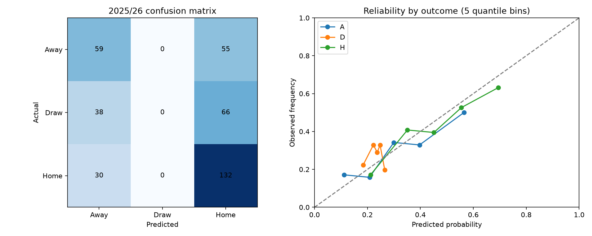

# ⚽ Football Match Predictor — Matchday Lab

A reproducible Premier League machine-learning project by **Eduard Szekely**. It estimates home-win, draw and away-win probabilities using only historical results available before a match.

The project demonstrates feature engineering, model training, chronological validation, probability evaluation and a Streamlit interface. It is an educational portfolio project, not a live forecasting service.

## Quick start

Python 3.11 or newer:

```bash
python3 -m venv .venv
source .venv/bin/activate
pip install -r requirements.txt
python -m football.data
python -m football.train
python -m pytest -q
streamlit run app.py
```

On Windows, activate with `.venv\Scripts\activate`. The download requires internet access; training and the demo work offline after that. Run commands from this repository's root. Training overwrites the generated model and report artifacts.

## The experiment

| Stage | Seasons | Purpose |
|---|---|---|
| Warm-up | 2015/16 | Initialize historical Elo ratings |
| Train | 2016/17–2023/24 | Fit candidate models |
| Validate | 2024/25 | Choose the lowest log-loss model |
| Test | 2025/26 | Evaluate frozen parameters on unseen matches |
| Demo refit | 2016/17–2025/26 | Separate snapshot model, fitted after evaluation |

The candidates are a class-frequency baseline, scaled multinomial logistic regression and histogram gradient boosting. All settings are fixed before evaluating the test season; the baseline is allowed to win. There is no shuffled train/test split and no tuning on test results.

### Features

- Home and away Elo, plus their difference.
- Difference in points, goals scored and goals conceded per game over each team's last five games.
- Number of available form matches for each team (0–5).

Features are recorded before processing that date's results. All matches on the same date use the same pre-date state. The dataset's current-match score is used only as the target and to update history for later dates. Betting odds, current-match shots and post-match statistics are excluded.

Elo has fixed K=20 and a 60-point home adjustment. At each season boundary, ratings regress 25% toward 1500 and form is reset. Teams unseen in the available Premier League history start at 1500. The model learns a home advantage through the outcome intercept; Elo's home adjustment is used for rating updates.

During validation/test, results from earlier completed test dates may update rolling features. Model parameters remain fixed. This simulates predictions made one match date at a time, not predicting an entire season in advance.

## Results

The included run selected **logistic regression** using 2024/25 validation. On the 380 held-out 2025/26 matches:

| Model | Accuracy | Log loss ↓ | Brier ↓ |
|---|---:|---:|---:|
| Outcome-frequency baseline | 42.6% | 1.0851 | 0.6565 |
| **Logistic regression** | **50.3%** | **1.0296** | **0.6183** |
| Gradient boosting | 49.2% | 1.0550 | 0.6324 |



Run training to produce [the evaluation report](reports/evaluation.md), [machine-readable metrics](reports/metrics.json), a confusion matrix, reliability plots and per-match test probabilities. The report states actual performance; no target accuracy is promised.

Primary metric: **log loss** (lower is better). Also reported: accuracy and multiclass Brier score, defined as the mean sum of three squared probability errors, with range 0–2. The reference model uses outcome frequencies learned only from its fitting data.

## Demo

Select a home and away team from the final test season. The interface shows three probabilities and the teams' form/Elo inputs. The demo is an end-of-data **historical snapshot**, not a current fixture prediction. Its model is refitted after the evaluation, so the test report is not a performance estimate for the refitted artifact itself.

## Data and attribution

Historical result files are downloaded from [Football-Data](https://www.football-data.co.uk/englandm.php), using the Premier League (`E0`) season CSVs. [Their notes](https://www.football-data.co.uk/notes.txt) document field meanings and source acknowledgements. Required columns: `Date`, `HomeTeam`, `AwayTeam`, `FTHG`, `FTAG`, `FTR`.

The downloader validates 380 completed matches per season, dates, goals, duplicate fixtures and outcome consistency. Downloaded raw files are ignored by Git; the manifest records URLs and SHA-256 hashes. Data belongs to its respective providers; this repository's code license does not grant rights over third-party data. Consult the source before redistribution or commercial use.

## Repository map

```text
football/data.py       Download, validation and source manifest
football/features.py   Historical state, Elo and rolling form
football/train.py      Model selection, evaluation and demo refit
app.py                Streamlit matchup explorer
tests/                Leakage, validation and app tests
reports/              Generated metrics, chart and test predictions
artifacts/            Generated models and snapshot (Git-ignored)
docs/                 Walkthrough and model card
```

## Limitations and next experiments

One test season is a small sample. Injuries, lineups, transfers, rest periods and lower-league strength are not modeled. Ratings for promoted teams are crude. Draws can be difficult to classify; accuracy alone hides that. Reliability plots on 380 matches are noisy. No profit or guaranteed-outcome claims are supported.

Future experiments: expanding-window backtests over several seasons, Poisson goal models, injury/lineup features available before kickoff, probability calibration fitted strictly on an earlier validation period, and better promoted-team priors. Any changes made after seeing this test result require a new untouched test period for an honest final assessment.

## Reproducibility

`requirements.txt` gives supported version ranges; `requirements-lock.txt` records the environment used for the included run. `reports/metrics.json` records Python and scikit-learn versions. Random seeds are fixed at 42. Dataset revisions can change results; compare manifest hashes. Only load locally generated/trusted joblib artifacts.

This project was built with AI-assisted implementation. Be prepared to explain and modify the pipeline yourself; [the walkthrough](docs/WALKTHROUGH.md) is intended for that.
